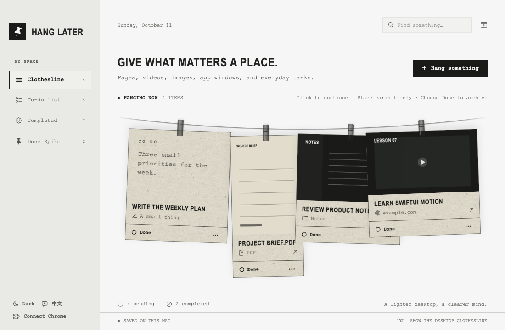
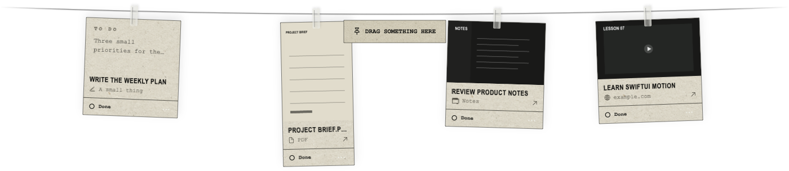
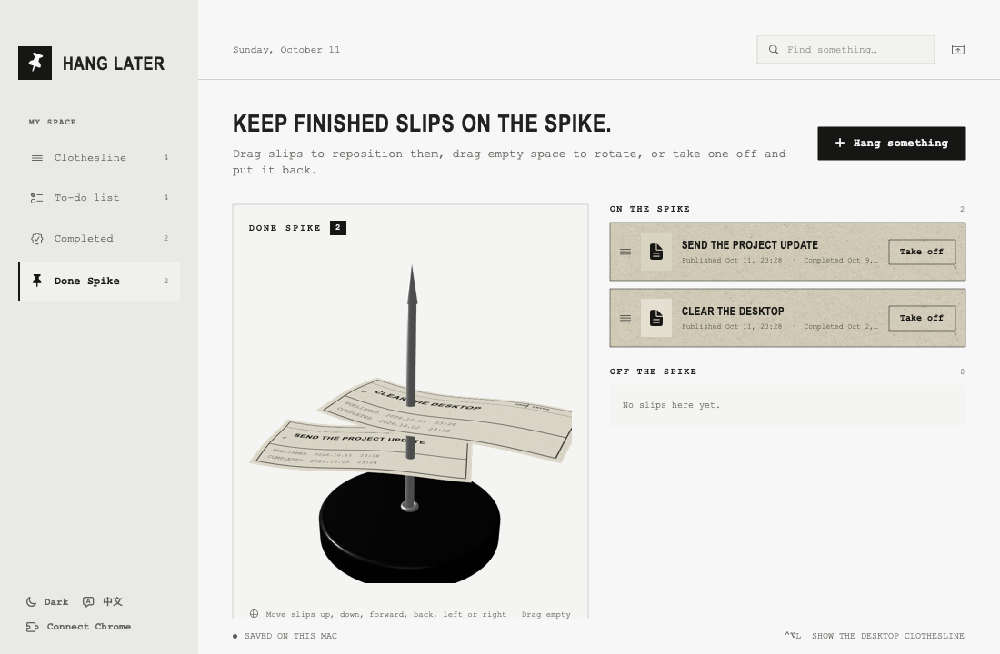

<a name="readme-top"></a>

<p align="center">
  
</p>

<h1 align="center">Hang Later</h1>

<p align="center">
  A clothesline for pages, files, app windows, and the things you want to return to.
</p>

<p align="center">
  <strong>English</strong> • <a href="#简体中文">简体中文</a>
</p>

<p align="center">
  Free and open source. Native macOS 14+.
</p>

<p align="center">
  <a href="https://github.com/yuxuanfuture/hang-later/releases/latest/download/HangLater.dmg"><strong>Download for macOS</strong></a>
  &nbsp;·&nbsp;
  <a href="#build-from-source">Build from source</a>
</p>



## Leave it where you can return to it.

Hang Later turns postponed work into something spatial. Hang a web page, video, image, PDF, app window, or plain task on the clothesline. When you have time again, click the slip and return to the original page, file, or app.

The desktop clothesline stays tucked above the screen. Rest the pointer on the Hang Later menu-bar pin, or press `⌃⌥L`, and it drops into view.



## Hang almost anything.

- **Web pages and videos** — save the title, exact URL, and visible page. When a visible video player is present, the Chrome extension crops the preview to the largest player.
- **Images and PDFs** — drag them from Finder or another app. PDFs keep the first page as a proportional thumbnail.
- **App windows** — drag a window title bar onto “Drag something here,” or choose a visible window from **Hang something**. Hang Later keeps a local screenshot and the app identity.
- **Plain tasks** — write a traditional to-do with notes and an optional due date.

Cards keep the proportions of their previews within a practical size range. Move them anywhere along the line, overlap them, and bring the last card you touched to the front.

The desktop clothesline includes a dashed drop target, so a file, image, link, or app window is added as soon as you release it inside the marked area.

## One click back.

Clicking a slip returns to its source:

- Chrome pages reopen from the saved URL, even after the original tab is closed.
- Obsidian windows resolve to their vault and note when the window title contains enough information.
- Images, PDFs, and files open in their default app.
- Apps without a document deep link, including terminals and remote-desktop clients, are reopened and brought to the front.

Some apps do not expose an internal document or scroll-position URL. For those apps, Hang Later restores the app rather than an exact internal state.

## Finish it. Keep the record.

Choose **Done** on a slip to move it into the archive. Use **Complete all** or **Delete all** to clear every slip currently visible on the clothesline in one action. Completed work can be grouped by day, week, or month, restored to the line, or deleted permanently.

The **Done Spike** turns the archive into a rotatable 3D receipt spike. It only shows slips published during the current workday. In **Settings**, define a workday that can cross midnight—such as 15:00 to 03:00—so late-night work stays with the day it belongs to. Drag slips onto or off the spike, move them up, down, forward, back, left, or right, and keep their published and completed times.



## A gesture for each action.

Action | Result
--- | ---
Click a slip | Return to its page, file, or app.
Drag a slip | Place it freely on the clothesline. Slips may overlap.
Choose **Done** | Move it to Completed and the Done Spike.
Choose **Complete all** | Complete every slip currently visible on the clothesline.
Choose **Delete all** | Permanently remove every slip currently visible on the clothesline.
Open `…` | Edit or delete a mistakenly added task.
Rest the pointer on the menu-bar pin | Reveal the desktop clothesline.
`⌃⌥L` | Show or hide the desktop clothesline.
`⌘N` | Open the source picker.

## Private by design.

Hang Later has no account, cloud sync, analytics, or telemetry. Tasks and previews stay in:

```text
~/Library/Application Support/HangLater/
```

Link previews may contact the page you add through macOS Link Presentation. The Chrome extension reads and captures the active page only when you click the extension or use its context-menu action. It does not automatically read browser history.

Window capture requires macOS Screen Recording permission. The captured preview remains local.

## Tech specs

 | |
--- | ---
Compatibility | macOS 14 Sonoma or later
Languages | English, Chinese (Simplified)
Built with | Swift, AppKit, SwiftUI, SceneKit, ScreenCaptureKit, PDFKit
Storage | Local JSON and PNG files
Network | Page metadata and user-initiated browser capture; no analytics
Price | Free
License | MIT

## Install

Download [HangLater.dmg](https://github.com/yuxuanfuture/hang-later/releases/latest/download/HangLater.dmg), open it, and drag Hang Later into **Applications**. A ZIP archive is also available on the [latest release](https://github.com/yuxuanfuture/hang-later/releases/latest) page.

The current community build is ad hoc signed and has not been notarized by Apple. On first launch, Control-click Hang Later in Applications, choose **Open**, then confirm **Open**. If macOS still blocks it, go to **System Settings → Privacy & Security** and choose **Open Anyway**.

## Build from source

Install Swift 6 through Xcode or the Command Line Tools, then run:

```sh
git clone https://github.com/yuxuanfuture/hang-later.git
cd hang-later
bash scripts/build-app.sh release
open build/HangLater.app
```

The build script creates `build/HangLater.app`, generates the complete macOS icon set, bundles the Chrome extension and native host, and applies a stable local ad hoc signature. macOS may ask for Screen Recording permission after a rebuild.

The app remains in the menu bar after its main window closes. Choose **Quit Hang Later** from the menu-bar menu to exit it.

## Connect Chrome

1. Open Hang Later and choose **Connect Chrome** in the lower-left corner. Install the native messaging host.
2. Open `chrome://extensions`, enable **Developer mode**, and choose **Load unpacked**.
3. Select the repository's `ChromeExtension` directory, or use **Show extension folder** in Hang Later.
4. Pin the Hang Later extension. Click it on a page to hang the current title, URL, and visible content.

The extension uses Chrome Native Messaging. There is no local HTTP server. Captures remain queued locally if Hang Later is closed and import on the next launch.

## Develop and verify

```sh
bash scripts/swift.sh run HangLaterChecks
python3 -m unittest discover -s NativeHost -p 'test_*.py'
node --check ChromeExtension/popup.js
node --check ChromeExtension/background.js
```

Generate privacy-safe README previews with sample data:

```sh
./build/HangLater.app/Contents/MacOS/HangLater \
  --render-main-preview /tmp/hang-later.png --sample-data --english
```

See [docs/VERIFICATION.md](docs/VERIFICATION.md) for the complete validation checklist.

## Project map

File | Role
--- | ---
`AppDelegate.swift` | Windows, menu bar, desktop reveal behavior, global shortcut
`DesktopLine.swift` | Transparent desktop panel and drop target
`HangingCard.swift` | Adaptive paper cards, free positioning, overlap, drag motion
`AppStore.swift` | Tasks, previews, opening targets, Chrome inbox, persistence glue
`ReceiptSpike3D.swift` | Interactive SceneKit Done Spike and receipt textures
`WindowCapture.swift` | ScreenCaptureKit window picker and local previews
`HangLaterCore/` | Persistence, completion grouping, drag input, bridge manifest
`ChromeExtension/` | Manifest V3 extension for user-initiated page capture
`NativeHost/` | Chrome Native Messaging host

## Acknowledgments

The desktop clothesline interaction is inspired by [Alejandro Buján's Tendedero](https://github.com/alejandrobujan/tendedero). The floating desktop panel, rope geometry, and global hotkey implementation are adapted from or informed by its MIT-licensed source. Hang Later uses its own name, icon, task model, interface, and artwork. See [THIRD_PARTY_NOTICES.md](THIRD_PARTY_NOTICES.md).

## License

[MIT](LICENSE) © 2026 Yuxuan Fu.

---

<a name="简体中文"></a>

<p align="center">
  
</p>

<h1 align="center">Hang Later</h1>

<p align="center">
  把网页、文件、App 页面和稍后想做的事情，先挂在一根晾衣绳上。
</p>

<p align="center">
  <a href="#readme-top">English</a> • <strong>简体中文</strong>
</p>

<p align="center">
  免费开源。原生支持 macOS 14 及以上。
</p>

<p align="center">
  <a href="https://github.com/yuxuanfuture/hang-later/releases/latest/download/HangLater.dmg"><strong>直接下载 macOS 版</strong></a>
  &nbsp;·&nbsp;
  <a href="#从源码构建">从源码构建</a>
</p>


## 给想做的事，留一个位置。

Hang Later 把暂时放下的事情变成桌面上的实体位置。网页、视频、图片、PDF、App 窗口和普通待办都可以挂到绳子上。重新有空时，点击纸片就能回到原来的页面、文件或 App。

桌面晾衣绳平时藏在屏幕上方。把鼠标停在菜单栏的 Hang Later 别针上，或按下 `⌃⌥L`，绳子就会落下来。


## 什么都可以先晾起来。

- **网页和视频**：保存标题、完整链接和当前可见画面。Chrome 页面中有可见视频时，扩展会自动裁出最大的播放器作为预览。
- **图片和 PDF**：从 Finder 或其他 App 直接拖入。PDF 按第一页的原始比例显示缩略图。
- **App 窗口**：把窗口标题栏拖到 “Drag something here”，或在「晾一件事」中选择可见窗口。Hang Later 会保存本地截图和 App 身份。
- **普通待办**：记录传统任务、备注和可选截止日期。

纸片会在合理尺寸范围内保持预览图比例。它们可以自由移动、互相重叠，最后操作的纸片会留在最上方。

桌面晾衣绳带有清晰的虚线投放区。文件、图片、链接或 App 窗口只要在框内松开，就会加入晾衣绳。

## 点一下，直接回去。

点击纸片会回到它的来源：

- Chrome 页面从保存的链接重新打开，即使原标签页已经关闭。
- Obsidian 窗口在标题信息足够时，会解析对应的 vault 和笔记。
- 图片、PDF 和其他文件使用系统默认 App 打开。
- 终端、远程桌面等没有文档深链的 App 会被重新打开并带到前台。

部分 App 不提供内部文档、滚动位置或编辑状态的链接。遇到这种情况，Hang Later 会恢复对应 App，而无法保证恢复内部的精确位置。

## 做完以后，留下记录。

点击纸片上的「完成」，任务会进入归档。使用「全部完成」或「全部删除」，可以一次处理晾衣绳上当前可见的所有纸片。完成记录可以按日、周、月分组，也可以重新挂回绳子或永久删除。

「完成钉」把归档变成一个可旋转的 3D 订单钉，并且只显示当前工作日内发布的纸片。你可以在「设置」中定义跨过凌晨的工作日，例如 15:00 到次日 03:00，让深夜完成的工作仍归入正确的一天。纸片可以取下、重新串上，也可以上下、前后、左右移动，并保留发布时间和完成时间。


## 每个动作都有明确结果。

动作 | 结果
--- | ---
点击纸片 | 回到对应网页、文件或 App。
拖动纸片 | 自由放在绳子的任意位置，可以互相重叠。
点击「完成」 | 移入已完成归档和完成钉。
点击「全部完成」 | 完成晾衣绳上当前可见的全部纸片。
点击「全部删除」 | 永久删除晾衣绳上当前可见的全部纸片。
打开 `…` | 编辑，或删除误添加的任务。
鼠标停在菜单栏别针上 | 显示桌面晾衣绳。
`⌃⌥L` | 显示或收起桌面晾衣绳。
`⌘N` | 打开来源选择器。

## 隐私是设计前提。

Hang Later 没有账号、云同步、行为统计或遥测。任务和预览都保存在：

```text
~/Library/Application Support/HangLater/
```

添加网页时，macOS Link Presentation 可能会访问该页面以获取标题和预览。Chrome 扩展只会在你点击扩展或使用右键菜单时读取并截取当前页面，不会自动读取浏览历史。

截取 App 窗口需要 macOS 的「屏幕录制」权限，生成的预览只保存在本机。

## 技术规格

 | |
--- | ---
兼容性 | macOS 14 Sonoma 及以上
语言 | English、简体中文
技术栈 | Swift、AppKit、SwiftUI、SceneKit、ScreenCaptureKit、PDFKit
存储 | 本地 JSON 与 PNG 文件
联网行为 | 网页元数据与用户主动触发的浏览器截取；无统计
价格 | 免费
许可证 | MIT

## 安装

下载 [HangLater.dmg](https://github.com/yuxuanfuture/hang-later/releases/latest/download/HangLater.dmg)，打开后把 Hang Later 拖进「应用程序」。[最新发布页面](https://github.com/yuxuanfuture/hang-later/releases/latest)也提供 ZIP 压缩包。

当前社区构建使用 ad hoc 签名，尚未通过 Apple 公证。首次启动时，请在「应用程序」中按住 Control 点击 Hang Later，选择「打开」，然后再次确认「打开」。如果仍被拦截，可进入「系统设置 → 隐私与安全性」，点击「仍要打开」。

## 从源码构建

先通过 Xcode 或 Command Line Tools 安装 Swift 6，然后运行：

```sh
git clone https://github.com/yuxuanfuture/hang-later.git
cd hang-later
bash scripts/build-app.sh release
open build/HangLater.app
```

构建脚本会生成 `build/HangLater.app`、完整的 macOS 图标组、Chrome 扩展和 Native Messaging 本地主机，并使用稳定的本地 ad hoc 签名。重新构建后，macOS 可能会再次询问「屏幕录制」权限。

关闭主窗口后，应用仍会在菜单栏运行。需要从菜单栏选择「退出 Hang Later」才能完全退出。

## 连接 Chrome

1. 打开 Hang Later，点击左下角的「连接 Chrome」，安装 Native Messaging 本地主机。
2. 打开 `chrome://extensions`，开启「开发者模式」，选择「加载已解压的扩展程序」。
3. 选择仓库中的 `ChromeExtension` 文件夹；也可以在 Hang Later 中点击「显示扩展文件夹」。
4. 把 Hang Later 扩展固定到工具栏。点击扩展，即可保存当前页面的标题、链接和可见内容。

扩展通过 Chrome Native Messaging 工作，不会启动本地 HTTP 服务。Hang Later 没有运行时，截取内容会暂存在本地，并在下次启动时自动导入。

## 开发与验证

```sh
bash scripts/swift.sh run HangLaterChecks
python3 -m unittest discover -s NativeHost -p 'test_*.py'
node --check ChromeExtension/popup.js
node --check ChromeExtension/background.js
```

使用无个人内容的演示数据生成 README 截图：

```sh
./build/HangLater.app/Contents/MacOS/HangLater \
  --render-main-preview /tmp/hang-later.png --sample-data
```

完整验证清单见 [VERIFICATION.md](docs/VERIFICATION.md)。

## 项目结构

文件 | 作用
--- | ---
`AppDelegate.swift` | 窗口、菜单栏、桌面呼出逻辑和全局快捷键
`DesktopLine.swift` | 桌面透明面板和拖放目标
`HangingCard.swift` | 自适应纸片、自由位置、重叠和拖动动画
`AppStore.swift` | 任务、预览、打开目标、Chrome 收件箱和持久化衔接
`ReceiptSpike3D.swift` | SceneKit 完成钉与纸片纹理
`WindowCapture.swift` | ScreenCaptureKit 窗口选择与本地预览
`HangLaterCore/` | 持久化、完成分组、拖入数据与桥接配置
`ChromeExtension/` | 用户主动截取页面的 Manifest V3 扩展
`NativeHost/` | Chrome Native Messaging 本地主机

## 致谢

桌面晾衣绳交互受到 [Alejandro Buján 的 Tendedero](https://github.com/alejandrobujan/tendedero) 启发。浮动桌面面板、绳子几何和全局快捷键实现参考或改编自其 MIT 许可源码。Hang Later 使用独立的名称、图标、任务模型、界面和美术资源。详见 [THIRD_PARTY_NOTICES.md](THIRD_PARTY_NOTICES.md)。

## 许可证

[MIT](LICENSE) © 2026 Yuxuan Fu。
