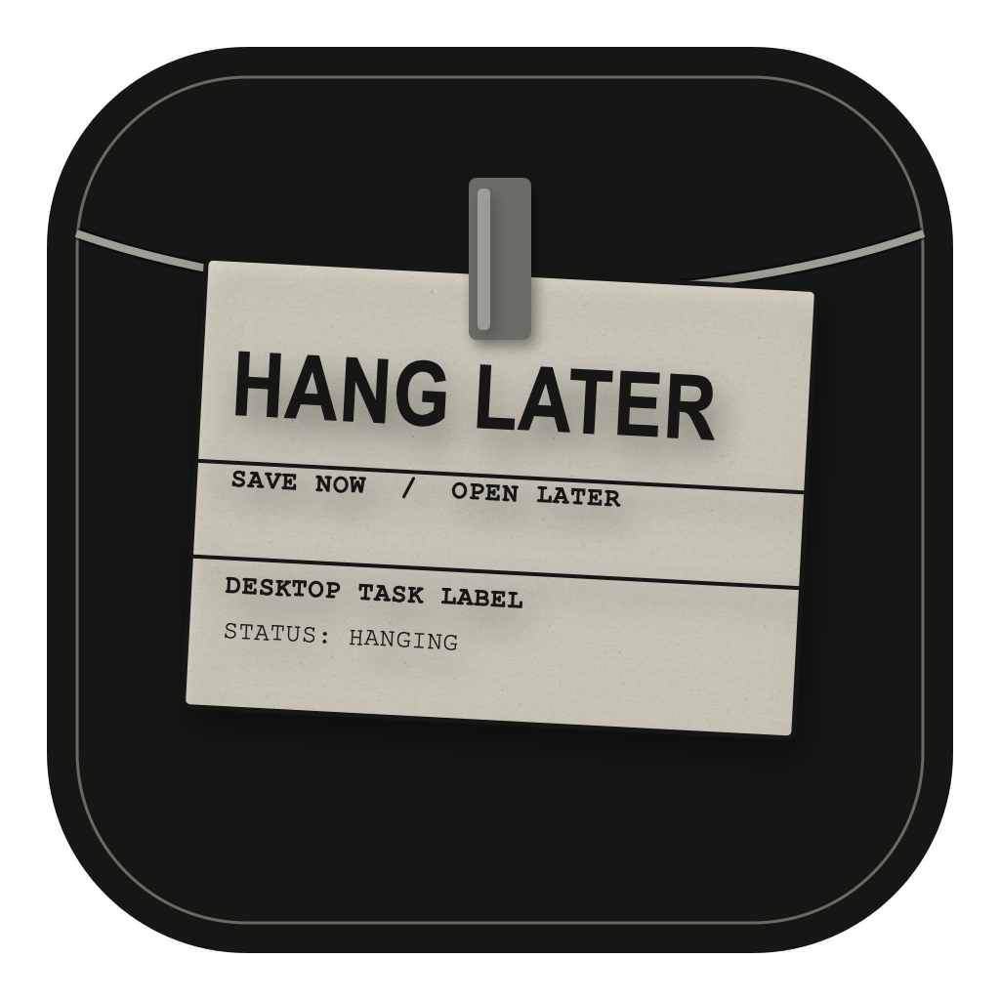
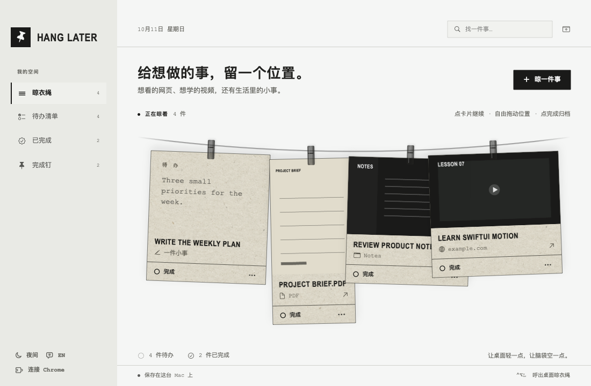
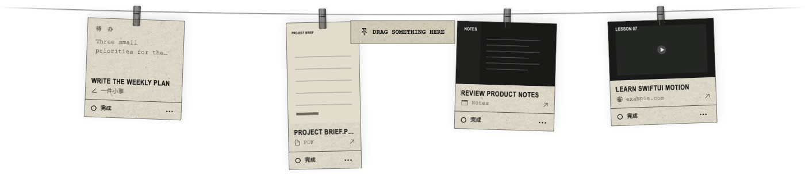
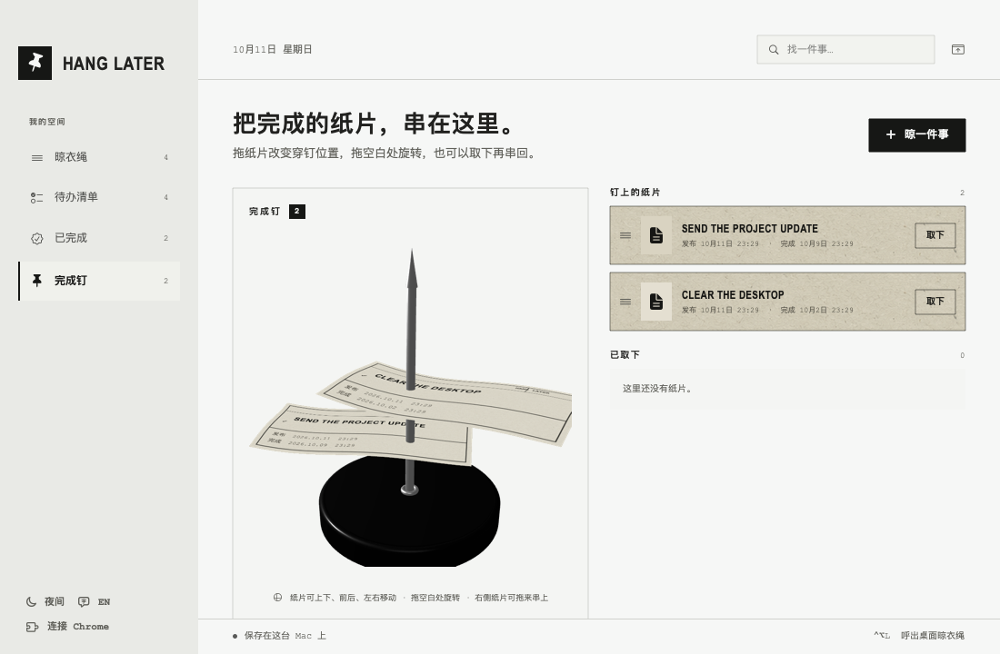

<p align="center">
  
</p>

<h1 align="center">Hang Later</h1>

<p align="center">
  把网页、文件、App 页面和稍后想做的事情，先挂在一根晾衣绳上。
</p>

<p align="center">
  <a href="../README.md">English</a> • <strong>简体中文</strong>
</p>

<p align="center">
  免费开源。原生支持 macOS 14 及以上。
</p>

<p align="center">
  <a href="https://github.com/yuxuanfuture/hang-later/releases/latest/download/HangLater.dmg"><strong>直接下载 macOS 版</strong></a>
  &nbsp;·&nbsp;
  <a href="#从源码构建">从源码构建</a>
</p>



## 给想做的事，留一个位置。

Hang Later 把暂时放下的事情变成桌面上的实体位置。网页、视频、图片、PDF、App 窗口和普通待办都可以挂到绳子上。重新有空时，点击纸片就能回到原来的页面、文件或 App。

桌面晾衣绳平时藏在屏幕上方。把鼠标停在菜单栏的 Hang Later 别针上，或按下 `⌃⌥L`，绳子就会落下来。



## 什么都可以先晾起来。

- **网页和视频**：保存标题、完整链接和当前可见画面。Chrome 页面中有可见视频时，扩展会自动裁出最大的播放器作为预览。
- **图片和 PDF**：从 Finder 或其他 App 直接拖入。PDF 按第一页的原始比例显示缩略图。
- **App 窗口**：把窗口标题栏拖到 “Drag something here”，或在「晾一件事」中选择可见窗口。Hang Later 会保存本地截图和 App 身份。
- **普通待办**：记录传统任务、备注和可选截止日期。

纸片会在合理尺寸范围内保持预览图比例。它们可以自由移动、互相重叠，最后操作的纸片会留在最上方。

## 点一下，直接回去。

点击纸片会回到它的来源：

- Chrome 页面从保存的链接重新打开，即使原标签页已经关闭。
- Obsidian 窗口在标题信息足够时，会解析对应的 vault 和笔记。
- 图片、PDF 和其他文件使用系统默认 App 打开。
- 终端、远程桌面等没有文档深链的 App 会被重新打开并带到前台。

部分 App 不提供内部文档、滚动位置或编辑状态的链接。遇到这种情况，Hang Later 会恢复对应 App，而无法保证恢复内部的精确位置。

## 做完以后，留下记录。

点击纸片上的「完成」，任务会进入归档。完成记录可以按日、周、月分组，也可以重新挂回绳子或永久删除。

「完成钉」把归档变成一个可旋转的 3D 订单钉。纸片可以取下、重新串上，也可以上下、前后、左右移动，并保留发布时间和完成时间。



## 每个动作都有明确结果。

动作 | 结果
--- | ---
点击纸片 | 回到对应网页、文件或 App。
拖动纸片 | 自由放在绳子的任意位置，可以互相重叠。
点击「完成」 | 移入已完成归档和完成钉。
打开 `…` | 编辑，或删除误添加的任务。
鼠标停在菜单栏别针上 | 显示桌面晾衣绳。
`⌃⌥L` | 显示或收起桌面晾衣绳。
`⌘N` | 打开来源选择器。

## 隐私是设计前提。

Hang Later 没有账号、云同步、行为统计或遥测。任务和预览都保存在：

```text
~/Library/Application Support/HangLater/
```

添加网页时，macOS Link Presentation 可能会访问该页面以获取标题和预览。Chrome 扩展只会在你点击扩展或使用右键菜单时读取并截取当前页面，不会自动读取浏览历史。

截取 App 窗口需要 macOS 的「屏幕录制」权限，生成的预览只保存在本机。

## 技术规格

 | |
--- | ---
兼容性 | macOS 14 Sonoma 及以上
语言 | English、简体中文
技术栈 | Swift、AppKit、SwiftUI、SceneKit、ScreenCaptureKit、PDFKit
存储 | 本地 JSON 与 PNG 文件
联网行为 | 网页元数据与用户主动触发的浏览器截取；无统计
价格 | 免费
许可证 | MIT

## 安装

下载 [HangLater.dmg](https://github.com/yuxuanfuture/hang-later/releases/latest/download/HangLater.dmg)，打开后把 Hang Later 拖进「应用程序」。[最新发布页面](https://github.com/yuxuanfuture/hang-later/releases/latest)也提供 ZIP 压缩包。

当前社区构建使用 ad hoc 签名，尚未通过 Apple 公证。首次启动时，请在「应用程序」中按住 Control 点击 Hang Later，选择「打开」，然后再次确认「打开」。如果仍被拦截，可进入「系统设置 → 隐私与安全性」，点击「仍要打开」。

## 从源码构建

先通过 Xcode 或 Command Line Tools 安装 Swift 6，然后运行：

```sh
git clone https://github.com/yuxuanfuture/hang-later.git
cd hang-later
bash scripts/build-app.sh release
open build/HangLater.app
```

构建脚本会生成 `build/HangLater.app`、完整的 macOS 图标组、Chrome 扩展和 Native Messaging 本地主机，并使用稳定的本地 ad hoc 签名。重新构建后，macOS 可能会再次询问「屏幕录制」权限。

关闭主窗口后，应用仍会在菜单栏运行。需要从菜单栏选择「退出 Hang Later」才能完全退出。

## 连接 Chrome

1. 打开 Hang Later，点击左下角的「连接 Chrome」，安装 Native Messaging 本地主机。
2. 打开 `chrome://extensions`，开启「开发者模式」，选择「加载已解压的扩展程序」。
3. 选择仓库中的 `ChromeExtension` 文件夹；也可以在 Hang Later 中点击「显示扩展文件夹」。
4. 把 Hang Later 扩展固定到工具栏。点击扩展，即可保存当前页面的标题、链接和可见内容。

扩展通过 Chrome Native Messaging 工作，不会启动本地 HTTP 服务。Hang Later 没有运行时，截取内容会暂存在本地，并在下次启动时自动导入。

## 开发与验证

```sh
bash scripts/swift.sh run HangLaterChecks
python3 -m unittest discover -s NativeHost -p 'test_*.py'
node --check ChromeExtension/popup.js
node --check ChromeExtension/background.js
```

使用无个人内容的演示数据生成 README 截图：

```sh
./build/HangLater.app/Contents/MacOS/HangLater \
  --render-main-preview /tmp/hang-later.png --sample-data
```

完整验证清单见 [VERIFICATION.md](VERIFICATION.md)。

## 项目结构

文件 | 作用
--- | ---
`AppDelegate.swift` | 窗口、菜单栏、桌面呼出逻辑和全局快捷键
`DesktopLine.swift` | 桌面透明面板和拖放目标
`HangingCard.swift` | 自适应纸片、自由位置、重叠和拖动动画
`AppStore.swift` | 任务、预览、打开目标、Chrome 收件箱和持久化衔接
`ReceiptSpike3D.swift` | SceneKit 完成钉与纸片纹理
`WindowCapture.swift` | ScreenCaptureKit 窗口选择与本地预览
`HangLaterCore/` | 持久化、完成分组、拖入数据与桥接配置
`ChromeExtension/` | 用户主动截取页面的 Manifest V3 扩展
`NativeHost/` | Chrome Native Messaging 本地主机

## 致谢

桌面晾衣绳交互受到 [Alejandro Buján 的 Tendedero](https://github.com/alejandrobujan/tendedero) 启发。浮动桌面面板、绳子几何和全局快捷键实现参考或改编自其 MIT 许可源码。Hang Later 使用独立的名称、图标、任务模型、界面和美术资源。详见 [THIRD_PARTY_NOTICES.md](../THIRD_PARTY_NOTICES.md)。

## 许可证

[MIT](../LICENSE) © 2026 Yuxuan Fu。
